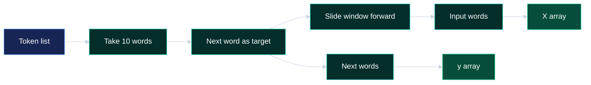
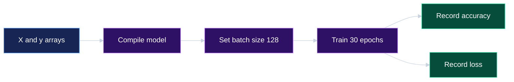
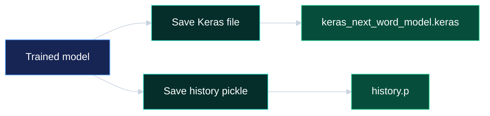
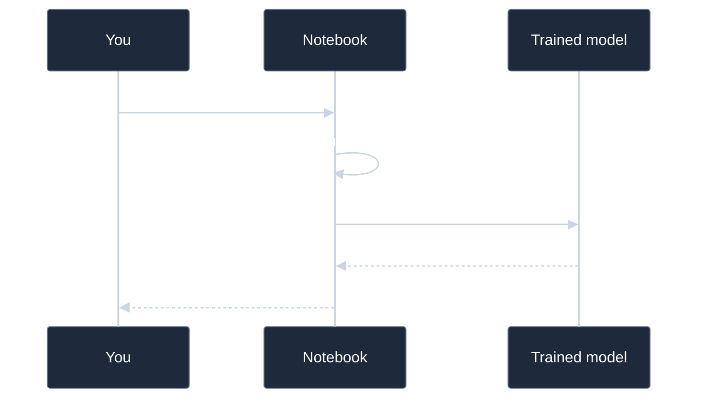

# next token gen model

A simple next word prediction project built with TensorFlow and Keras. The full workflow lives in `notebooks/Predictor_v1.ipynb`, together with the saved outputs from the original run.

It reads a public fake and real news dataset, turns article text into numbered tokens, learns from 10 word windows, saves the trained model, and then demonstrates prediction and text generation.

## Flow by stage

### Stage 1 Data analysis


Recorded result: 6,335 rows and 3 columns. The columns are title, text, and label.

### Stage 2 Data processing


This stage turns raw article text into a numbered vocabulary.

### Stage 3 Training data



Recorded result: X shape is 169677 by 10 and y shape is 169677.

### Stage 4 Model building


The model ends with a probability score for every known word.

### Stage 5 Training



Recorded result: first epoch accuracy 0.0747 and loss 7.0795. Final epoch accuracy 0.1592 and loss 5.9869.

### Stage 6 Saving



Artifacts are kept so training does not need to run again.

### Stage 7 Inference


### How one prediction travels



## Example output

**Top five predictions after "I will"**

1. **be**
2. **have**
3. **help**
4. **only**
5. **take**

**Generated continuation**

> **I will have killed a syrian turkish fighters forces and the united new minister old line on**

The generated sentence is rough, but it demonstrates the full loop: predict one word, append it, and predict again. The creativity setting controls how many top candidates are considered, so higher values give more varied output.

## Tech Stack

**Python** 3.12

**TensorFlow and Keras** model building and training

**NumPy and pandas** data handling

**NLTK** tokenization

**uv** environment and dependency management

## Project Structure

```text
README.md                          this documentation
pyproject.toml                     project metadata and dependencies
uv.lock                            locked dependency versions
Python version pin                 Python version used by uv
notebooks/Predictor_v1.ipynb       full notebook workflow
models/keras_next_word_model.keras trained Keras model
models/history.p                   pickled training history
```

The dataset is downloaded from a URL inside the notebook and is not stored in this repository.

## Setup

```bash
uv sync
```

Dependencies are declared in `pyproject.toml` and locked in `uv.lock`. There is no `requirements.txt`.

## Run the notebook

```bash
uv run jupyter notebook notebooks/Predictor_v1.ipynb
```

Run the cells in order. Data analysis and preparation are quick. The training cell takes about 90 minutes on the original machine.

## Dataset credit

The news dataset used by the notebook is the Fake and Real News Dataset shared by lutzhamel on GitHub. Thanks to the provider for making the data publicly available.

Source: https://github.com/lutzhamel/fake-news/blob/master/data/fake_or_real_news.csv

Copyright © 2026 Yasas Banu · [GitHub](https://github.com/yasasbanukaofficial) · [LinkedIn](https://www.linkedin.com/in/yasasbanukagunasena/) · [Website](https://www.yasasbanuka.tech/)
