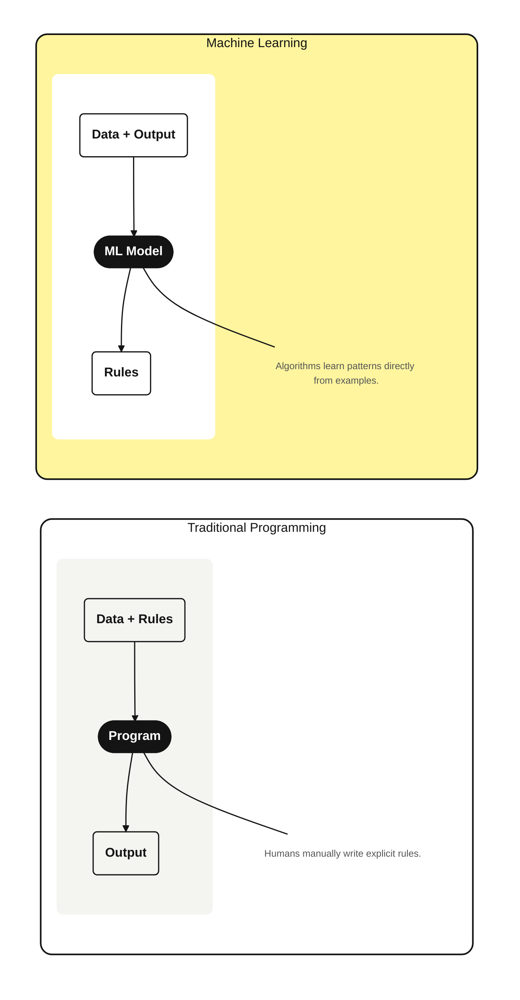

# next-token-gen-model


A lightweight next-token language model built with TensorFlow and Keras. Implements word-level tokenization over a news corpus, maps sequences into sliding 10-word context windows, and trains a 2-layer LSTM recurrent neural network with an embedding layer to predict the subsequent token across a 14,389-word vocabulary. The project also demonstrates autoregressive sequence generation with adjustable top-$k$ sampling creativity. Everything is self-contained across two focused notebooks for training and inference, with pre-trained weights ready to run out of the box.

### Installation

```bash
git clone https://github.com/yasasbanukaofficial/next-token-gen-model.git
cd next-token-gen-model
uv sync
```

### Example usage

Below is a self-contained snippet demonstrating how to load the pre-trained model and predict the most probable next words:

```python
import pickle
import numpy as np
from tensorflow.keras.models import load_model

model = load_model('models/keras_next_word_model.keras')

with open('data/processed/unique_tokens.p', 'rb') as f:
    unique_tokens = pickle.load(f)
with open('data/processed/unique_token_idx.p', 'rb') as f:
    unique_token_idx = pickle.load(f)

# Predict top 5 candidates for "I will"
words = "I will".lower().split()[-10:]
token_ids = [unique_token_idx.get(w, 0) for w in words]
X = np.array([[0] * (10 - len(token_ids)) + token_ids])

predictions = model.predict(X, verbose=0)[0]
top_5 = np.argsort(predictions)[-5:][::-1]

for idx in top_5:
    print(unique_tokens[idx])
# prints: be, have, help, only, take
```

### Text generation

The inference notebook `notebooks/text_generation.ipynb` demonstrates autoregressive generation: predicting the next token, appending it to the sequence, and repeating for a desired length. With an input prompt `"I will"` and creativity $k=2$:

> **I will have killed a syrian turkish fighters forces and the united new minister old line on**

### Training the model

The training pipeline in `notebooks/model_training.ipynb` downloads the Fake and Real News Dataset (6,335 articles), extracts the first 1,000,000 characters, builds a 14,389-word vocabulary, and generates 169,677 training pairs $(X, y)$ with a 10-word sliding window. 

The architecture consists of an `Embedding(14389, 128)` layer, two stacked `LSTM(128)` layers, and a `Dense(14389, activation='softmax')` head totaling 3.96M trainable parameters. The model is compiled with RMSprop and categorical cross-entropy, and trained for 30 epochs with batch size 128:

- **Epoch 1/30**: Loss: 7.0795 — Accuracy: 0.0747
- **Epoch 30/30**: Loss: 5.9869 — Accuracy: 0.1592

Trained artifacts are persisted to `models/keras_next_word_model.keras` and `models/train_history/history_v1.p`.

### How it works

Traditional programming requires manually specifying logic and rules. In machine learning, the model discovers the underlying statistical patterns directly from data:



### Tracing / pipeline visualization

How an input phrase travels through tokenization, context padding, 2-layer LSTM inference, and top-$k$ candidate selection:

```mermaid
%%{init: {"theme": "base", "themeVariables": {"background": "#F4F4F1", "primaryColor": "#FFFFFF", "primaryTextColor": "#141414", "primaryBorderColor": "#141414", "lineColor": "#141414", "textColor": "#141414", "fontSize": "14px", "fontFamily": "Inter, system-ui, -apple-system, BlinkMacSystemFont, 'Segoe UI', Roboto, sans-serif", "edgeLabelBackground": "#F4F4F1"}}}%%
flowchart LR
    A("Type phrase (You)") --> B("Tokenize & map to IDs (Notebook)")
    B --> C("Send 10-word input")
    C --> D(["Trained model"])
    D --> E("Probabilities over vocabulary")
    E --> F(["Show ranked next words (You)"])

    classDef source fill:#FFFFFF,stroke:#141414,stroke-width:1.5px,color:#141414,font-weight:600;
    classDef process fill:#FFFFFF,stroke:#141414,stroke-width:1.5px,color:#141414;
    classDef key fill:#141414,stroke:#141414,stroke-width:2px,color:#FFFFFF,font-weight:bold;
    classDef result fill:#FEF59E,stroke:#141414,stroke-width:1.5px,color:#141414,font-weight:600;

    class A source;
    class B,C,E process;
    class D key;
    class F result;

    linkStyle default stroke:#141414,stroke-width:1.5px;
```



### Project structure

```text
├── data/
│   └── processed/
│       ├── unique_tokens.p           # vocabulary word list (14,389 tokens)
│       └── unique_token_idx.p        # word-to-index mapping
├── models/
│   ├── keras_next_word_model.keras   # trained 2-layer LSTM model weights
│   └── train_history/history_v1.p    # training loss & accuracy metrics
├── notebooks/
│   ├── model_training.ipynb          # dataset prep, tokenization & 30-epoch training
│   └── text_generation.ipynb         # top-k next-token prediction & autoregressive sampling
├── docs/assets/                      # project imagery & reference diagrams
├── pyproject.toml                    # dependencies & project configuration
└── uv.lock                           # reproducible locked environment
```

### Running the notebooks

Launch Jupyter via `uv`:

```bash
uv run jupyter notebook notebooks/text_generation.ipynb
```

Run the cells in order. Data preparation is fast; training from scratch in `model_training.ipynb` takes ~90 minutes on CPU.

### Dataset credit

The news dataset used by the training notebook is the Fake and Real News Dataset shared by lutzhamel on GitHub. Thanks to the author for making the data publicly available:
https://github.com/lutzhamel/fake-news/blob/master/data/fake_or_real_news.csv

### License

MIT · Copyright © 2026 Yasas Banu · [GitHub](https://github.com/yasasbanukaofficial) · [LinkedIn](https://www.linkedin.com/in/yasasbanukagunasena/) · [Website](https://www.yasasbanuka.tech/)
